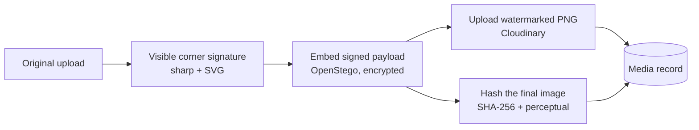
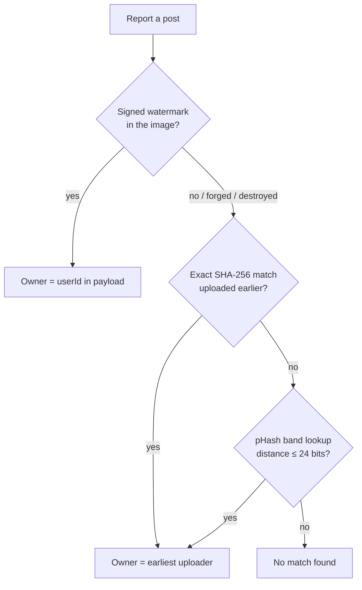

# CanvasGuard

A social platform for artists with artwork protection built in. Artists share their work, join communities and take commissions, and every upload can be watermarked, both visibly and invisibly, and checked against copies posted by other people.

**Live demo:** [canvasguard-1.onrender.com](https://canvasguard-1.onrender.com) · **Stack:** React, Tailwind CSS, React Query, Node.js, Express, MongoDB, Cloudinary, Socket.IO, sharp, OpenStego

<!-- Screenshots: add images to docs/screenshots/ and uncomment


-->

## Features

- **Artwork protection.** Visible corner signature, invisible signed watermark, and theft detection that still works on resized, recompressed or cropped copies.
- **Feed and posts.** Image posts with likes, comments, follows, and home and explore feeds.
- **Communities.** Create and join communities and post into them.
- **Commissions.** Artists set up a profile (styles, starting price, delivery time, open or closed). Clients send requests with reference images, and artists accept or decline them.
- **Auth.** Email-first signup with a 6-digit email code, login with email or username, optional profile picture with an initials placeholder.
- **Fast images.** Cloudinary `f_auto,q_auto` delivery at the right width, with a blurred placeholder stored at upload time, so images don't shift the layout while they load.
- **Light and dark themes,** with shimmer skeletons for loading states.

---

## How artwork protection works

Protection has three independent layers. Each one covers what the previous one can't.

| Layer | What it is | Survives | Breaks when |
|---|---|---|---|
| Visible signature | `© @username` in the bottom-right corner | Anything short of editing it out | Someone crops or paints over it |
| Invisible watermark | Signed ownership payload hidden in the pixels (OpenStego) | Lossless copies of the file | The image is recompressed or resized |
| Perceptual hashing | A fingerprint of what the image *looks like* | Recompression, resizing, format changes, centered crops | Heavy edits or off-center crops |

### 1. Watermarking



When an artist watermarks an upload (`POST /api/v1/posts/watermark`):

1. **Visible signature.** sharp composites `© @username` in the bottom-right corner. The text scales with the image and has a soft outline, so it reads on light and dark artwork.
2. **Invisible payload.** OpenStego hides this text in the image's least significant bits:
   ```
   canvasguard:v1
   userId:<owner id>
   mediaId:<media id>
   signature:<HMAC-SHA256(secret, "canvasguard:v1:<userId>:<mediaId>")>
   ```
   - The **HMAC signature** means a payload can't be forged. Anyone can run OpenStego on an image, but without the server's `WATERMARK_SECRET` they can't produce a signature that verifies. Signatures are compared in constant time (`crypto.timingSafeEqual`).
   - The payload is also **encrypted** with a password derived from the same secret, so other people can't read it either.
3. **Lossless output.** The result is saved as PNG, because JPEG compression would destroy the hidden bits.
4. **Bookkeeping.** The watermarked image gets its own Media record and hashes. Posts are pointed at the new image, and the unwatermarked original is deleted from Cloudinary.

Only the uploader can watermark an image, and each image can be watermarked only once.

### 2. Perceptual hashing

A SHA-256 hash only matches byte-for-byte copies. Once someone screenshots, resizes or re-saves an image as JPEG, the SHA-256 is completely different. A **perceptual hash** (pHash) is computed from the image's low-frequency structure, so visually identical images produce nearly identical hashes.

Every uploaded image stores:

- **`sha256`** for exact copies.
- **`phashVariants`**: six 256-bit pHashes (16×16) of the full image and of the crops people commonly make:

  | Variant | Catches |
  |---|---|
  | Full frame | Resized, recompressed or format-converted copies |
  | Center 85%, center 70% | Zoomed-in or trimmed copies |
  | Center 1:1, 4:5, 4:3 | Copies cropped for Instagram, portrait posts and landscape posts |

  EXIF rotation is applied first, so a phone photo hashes the way it's displayed.

- **`phashBands`**: an index for fast lookups (below).

Two images **match** when the closest pair of their variant hashes differs by **≤ 24 of 256 bits** (Hamming distance).

#### Fast lookup without scanning every image

Comparing a new image against every stored hash doesn't scale. Instead, each 256-bit hash is split into **16 bands of 16 bits**, stored as strings like `"3:a9f2"` in a multikey MongoDB index:

```
hash   a9f2 03bc 77e1 ... (16 bands)
bands  ["0:a9f2", "1:03bc", "2:77e1", ...]
```

By the pigeonhole principle, if two hashes differ in at most 15 bits, then at least one of the 16 bands is identical. So a single indexed query (`phashBands: { $in: [...] }`) returns every possible near-match. The exact distance is then computed only for that small candidate set. Near-duplicates usually differ by fewer than 10 bits, so the 24-bit threshold is also met in practice.

### 3. Verifying ownership (theft reports)



`POST /api/v1/posts/verify` checks a reported post in order of the strongest evidence first:

1. **Watermark.** Extract the payload and verify its HMAC. A valid signature names the owner directly.
2. **Exact copy.** Look up an older Media record with the same SHA-256.
3. **Visual copy.** Banded pHash lookup for the **oldest** earlier upload by a different user within the threshold.

The response says how it was verified (`watermark`, `sha256` or `hash`), who the original owner is, and whether the image was taken from the person reporting it. Reporting your own post is rejected.

### Limitations

- **The invisible watermark is fragile.** Any recompression destroys it, including a screenshot, a JPEG re-save, or Cloudinary's optimized delivery. It's strong proof when it survives, which is why hashing is the fallback rather than an afterthought.
- **Off-center crops** (e.g. cutting out one corner of a piece) aren't caught by the center-crop variants. Catching them would need keypoint matching, such as ORB or SIFT feature descriptors.
- **"First upload wins."** The original owner is assumed to be whoever uploaded first *on CanvasGuard*. Art first posted elsewhere and uploaded here by someone else can't be told apart.

---

## Project structure

```
backend/
  controllers/     auth, posts, watermark, commissions, communities, users
  model/           Mongoose schemas (User, Post, Media, Community, CommissionDetail, ...)
  utils/
    hashUtils.js       SHA-256 + crop-variant pHash + band index
    watermarkUtils.js  HMAC payload, OpenStego embed/extract, visible signature
    imageUtils.js      blur placeholders
    mailer.js, otp.js  OTP emails, expiry, cooldown and attempt limits
  scripts/backfillImageHashes.js
frontend/src/
  app/             providers, router
  features/        auth, posts, communities, commissions, profiles, ...
                   (each with api/ hooks on React Query, components/, pages/)
  components/ui/   OptimizedImage, Skeleton, PageLoader, ...
  theme/           design tokens for light/dark
```

## Running locally

**Requirements:** Node 20+, Java 8+ (for OpenStego), a MongoDB database, a Cloudinary account, and an email account for OTP emails.

1. **Get OpenStego.** Download `openstego.jar` from the [OpenStego releases](https://github.com/syvaidya/openstego/releases) and place it at `backend/vendor/openstego.jar`, or point `OPENSTEGO_JAR` at it.

2. **Backend** (`backend/.env`):
   ```env
   PORT=8000
   MONGO_URL=mongodb+srv://...    # local dev: mongodb://127.0.0.1:27017/canvasguard-dev
   JWT_SECRET=...
   WATERMARK_SECRET=...          # keep stable: changing it invalidates existing watermarks
   CLOUDINARY_CLOUD_NAME=...
   CLOUDINARY_API_KEY=...
   CLOUDINARY_API_SECRET=...
   EMAIL_USER=...                # SMTP sender for OTP emails
   EMAIL_PASS=...                # app password
   # OPENSTEGO_JAR=/path/to/openstego.jar
   # CLOUDINARY_FOLDER=dev            # keep local uploads in their own folder
   ```
   ```bash
   cd backend && npm install && npm start
   ```

3. **Frontend** (`frontend/.env`):
   ```env
   VITE_SERVER=http://localhost:8000
   ```
   ```bash
   cd frontend && npm install && npm run dev
   ```

4. **Existing data.** If you have images uploaded before crop-variant hashing was added, run `npm run backfill:hashes` in `backend/` (add `--dry-run` to preview).

**Docker:** `backend/Dockerfile` installs Java, downloads the OpenStego jar, and sets `OPENSTEGO_JAR`.

## API overview

All routes are under `/api/v1`. Authentication uses an httpOnly JWT cookie.

| Area | Routes |
|---|---|
| Auth | `POST /auth/signup` · `POST /auth/verify` · `POST /auth/resend-otp` · `POST /auth/login` · `GET /auth/logout` · `POST /auth/artistProfile` |
| Posts | `POST /posts/upload` · `POST /posts/watermark` · `POST /posts/verify` · `POST /posts/createPost` · `GET /posts` · `GET /posts/:postId` · `DELETE /posts/:postId` · `POST /posts/like` · `POST /posts/unlike` |
| Users | `GET /user/me` · `PUT /user/me` · `GET /user/:userName` · `POST /user/follow` · `POST /user/unfollow` · `GET /user/notification` |
| Communities | `GET /community/all` · `POST /community/create` · `GET /community/my` · `GET /community/feed/home` · `GET /community/feed/explore` · `GET /community/:communityId` · `POST /community/join/:id` · `POST /community/leave/:id` |
| Commissions | `GET /commissions/get` · `POST /commissions/requestCommission` · `GET /commissions/getCommissionReqs` · `POST /commissions/confirmCommissionReq/:id` |
| Comments | `POST /comment` · `DELETE /comment/:id` · `POST /comment/:id/like` · `POST /comment/:id/unlike` |

## Roadmap

- Report and takedown flow after a theft match
- Commission chat and payments (Razorpay)
- Community detail pages and pagination
- Password reset
- Clickable hashtags with tag filtering
- Keypoint matching for off-center crops
